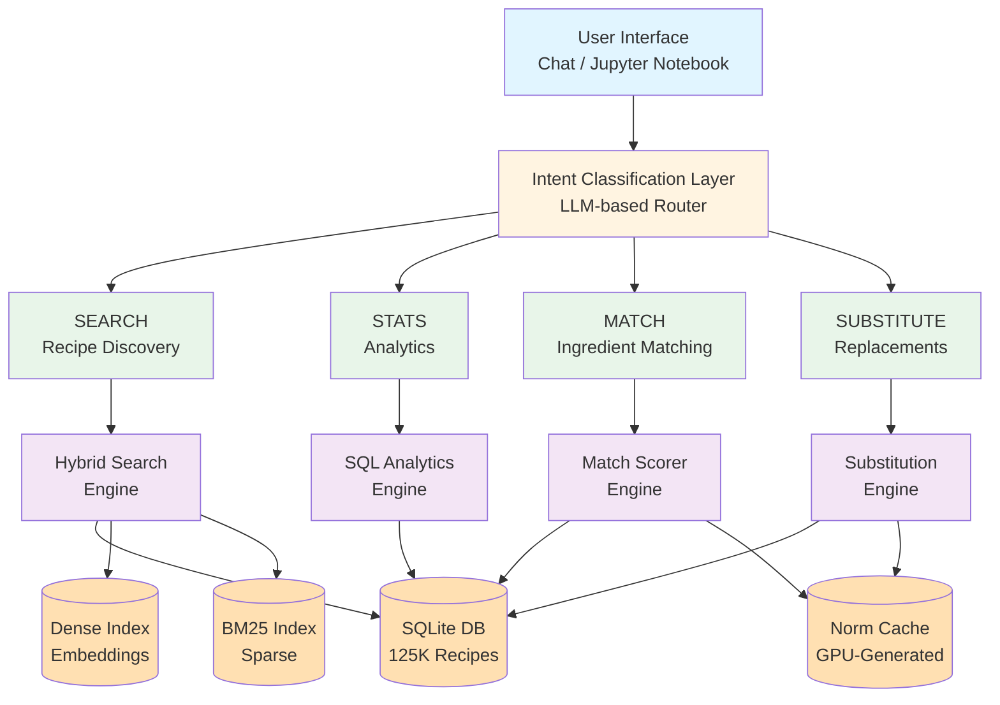
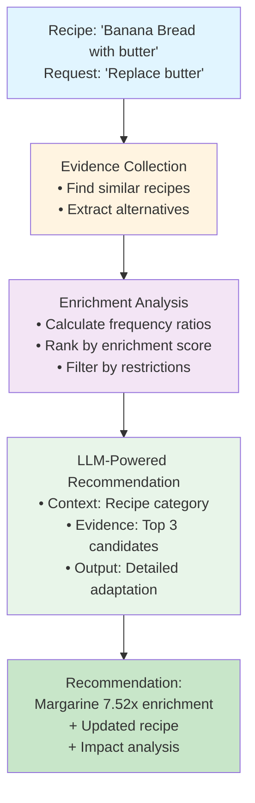

# 🍳 Recipe Intelligence Chatbot

<div align="center">

[](https://www.python.org/)
[](https://pytorch.org/)
[](https://python.langchain.com/)
[](LICENSE)

**An intelligent conversational agent that understands recipes, matches ingredients, and provides evidence-based culinary recommendations**

[Features](#-features) • [Architecture](#-architecture) • [Installation](#-installation) • [Usage](#-usage) • [Documentation](#-documentation)

</div>

---

## 📖 Overview

The **Recipe Intelligence Chatbot** is an advanced conversational AI system that combines hybrid search, semantic understanding, and evidence-based reasoning to help users discover recipes, match ingredients, compute statistics, and suggest intelligent substitutions. Built on top of 125,000+ recipes from AllRecipes, Epicurious, and Food Network.

### 🎯 Key Capabilities

- **🔍 Semantic Recipe Search**: Natural language queries with HyDE (Hypothetical Document Embeddings) enhancement
- **📊 Recipe Analytics**: Statistical analysis including ingredient frequency, recipe counts, and rankings
- **🥘 Ingredient Matching**: Smart recipe suggestions based on available ingredients with match scoring
- **🔄 Evidence-Based Substitutions**: Data-driven ingredient replacement recommendations using enrichment analysis
- **💬 Conversational Context**: Stateful conversations with dietary restrictions and constraint tracking

---

## ✨ Features

### 1. **Hybrid Search Engine**
- **Dense Retrieval**: BGE embeddings with semantic similarity search
- **Sparse Retrieval**: BM25 keyword-based ranking
- **HyDE Enhancement**: LLM-generated hypothetical recipes improve search quality
- **Cross-Encoder Reranking**: Final refinement using BGE reranker
- **Ensemble Fusion**: Weighted combination of dense (60%) and sparse (40%) results

### 2. **Intelligent Ingredient Normalization**
- GPU-accelerated batch processing using Qwen2.5-1.5B-Instruct
- Automatic extraction of base ingredients from complex descriptions
- Caching mechanism for efficient repeated lookups

### 3. **Multi-Intent Classification**
- **SEARCH**: Recipe discovery with natural language understanding
- **STATS**: Analytical queries (counts, rankings, distributions)
- **MATCH**: Recipe recommendations from available ingredients
- **SUBSTITUTE**: Evidence-based ingredient replacement suggestions

### 4. **Conversation Management**
- Stateful context tracking across multiple turns
- Dynamic constraint extraction (dietary restrictions, step limits)
- Follow-up query support with context retention

---

## 🏗️ Architecture

### System Architecture

<div align="center">



</div>

### Hybrid Search Pipeline

<div align="center">

```mermaid
graph TD
    Q[User Query:<br/>'Find a vegan chocolate dessert']
    
    HYDE[HyDE Generation<br/>LLM creates hypothetical recipe]
    
    PS[Parallel Search]
    
    DENSE[Dense Search<br/>BGE Embeddings<br/>Semantic Similarity]
    SPARSE[Sparse Search<br/>BM25<br/>Keyword Matching]
    
    T15[Top 15 Results]
    T10[Top 10 Results]
    
    FUSION[Ensemble Fusion<br/>Weighted Merge<br/>Dense: 60% | Sparse: 40%]
    
    RERANK[Cross-Encoder Reranking<br/>BGE Reranker]
    
    FINAL[Final Top 5 Recipes]
    
    Q --> HYDE
    HYDE --> PS
    PS --> DENSE
    PS --> SPARSE
    DENSE --> T15
    SPARSE --> T10
    T15 --> FUSION
    T10 --> FUSION
    FUSION --> RERANK
    RERANK --> FINAL
    
    style Q fill:#e1f5ff
    style HYDE fill:#fff4e1
    style PS fill:#f3e5f5
    style DENSE fill:#e8f5e9
    style SPARSE fill:#e8f5e9
    style T15 fill:#e3f2fd
    style T10 fill:#e3f2fd
    style FUSION fill:#fff9c4
    style RERANK fill:#f8bbd0
    style FINAL fill:#c8e6c9
```

</div>

### Ingredient Substitution Flow

<div align="center">



</div>

---

## 🚀 Installation

### Prerequisites

- Python 3.8+
- CUDA-capable GPU (optional, for faster processing)
- 8GB+ RAM
- 10GB+ free disk space

### Step 1: Clone the Repository

```bash
git clone https://github.com/AtharvaMate/recipe-chatbot.git
cd recipe-chatbot
```

### Step 2: Create Virtual Environment

```bash
python -m venv .venv
source .venv/bin/activate  # On Windows: .venv\Scripts\activate
```

### Step 3: Install Dependencies

```bash
pip install -r requirements.txt
```

### Step 4: Set Up Environment Variables

Create a `.env` file in the project root:

```env
# Required for LLM functionality
GROQ_API_KEY=your_groq_api_key_here
ANTHROPIC_API_KEY=your_anthropic_api_key_here  # Optional: for Claude fallback

# Optional: Local Omniroute API
OMNIROUTE_BASE_URL=http://localhost:20128/v1/chat/completions
```

### Step 5: Download Recipe Dataset

Place the following JSON files in `recipes_raw/` directory:
- `recipes_raw_nosource_ar.json` (AllRecipes)
- `recipes_raw_nosource_epi.json` (Epicurious)
- `recipes_raw_nosource_fn.json` (Food Network)

### Step 6: Initialize Database (First Run)

The database will be automatically created on first run. This may take 10-20 minutes for ingredient normalization.

---

## 💻 Usage

### Interactive Chat Mode

```python
from recipe_chatbot_final import chat

# Start interactive session
chat()
```

**Example Conversation:**

```
🧑 You: Find a quick chocolate dessert without eggs
🤖 Bot: Found 5 recipes. Showing top 5:

1. **Chocolate Ganache**
   Steps: 7
   Ingredients: semisweet chocolate, heavy cream, flavoring...

2. **Sorbetto di Cioccolato**
   Steps: 17
   Ingredients: bittersweet chocolate, water, sugar...
```

### Programmatic Usage

```python
from recipe_chatbot_final import (
    ConversationState,
    process_query,
    search_recipes,
    match_recipes,
    suggest_substitution
)

# Initialize conversation state
state = ConversationState()

# 1. Search for recipes
response = process_query("Find Italian pasta recipes", state)
print(response)

# 2. Get statistics
response = process_query("How many recipes contain garlic and onion?", state)
print(response)

# 3. Match ingredients
state.user_ingredients = ["eggs", "flour", "milk"]
response = process_query("What can I make?", state)
print(response)

# 4. Suggest substitutions
response = process_query("Replace eggs in this recipe", state)
print(response)
```

### Query Examples

#### Recipe Search
```
- "Find a vegan chocolate cake"
- "Quick breakfast recipes under 5 steps"
- "Italian pasta without dairy"
```

#### Analytics
```
- "How many recipes contain both garlic and onion?"
- "Show me the simplest recipes with chicken"
- "What percentage of recipes are vegetarian?"
```

#### Ingredient Matching
```
- "I have chicken, rice, and tomatoes"
- "What can I make with eggs and flour? No nuts, at most 6 steps"
```

#### Substitutions
```
- "Replace butter in this recipe"
- "Find an egg substitute for baking"
- "I'm allergic to dairy, what can I use instead?"
```

---

## 📊 Technical Details

### Models & Technologies

| Component | Technology | Purpose |
|-----------|-----------|---------|
| **Ingredient Normalization** | Qwen2.5-1.5B-Instruct | Extract base ingredients |
| **Dense Embeddings** | BAAI/bge-small-en-v1.5 | Semantic search |
| **Sparse Retrieval** | BM25Okapi | Keyword matching |
| **Reranker** | BAAI/bge-reranker-base | Final ranking refinement |
| **Intent Classification** | Groq (GPT-OSS-20B) | Query routing |
| **Reasoning** | Claude Sonnet 4.6 / Omniroute | Substitution & HyDE |
| **Database** | SQLite | Recipe storage |

### Performance Metrics

- **Database**: 125,164 recipes indexed
- **Search Latency**: ~500ms (with reranking)
- **Ingredient Normalization**: ~200 ingredients/second (GPU)
- **Embedding Cache**: Persistent (embeddings.npy)
- **Memory Usage**: ~2GB (with models loaded)

### Database Schema

```sql
-- Recipes table
CREATE TABLE recipes (
    id TEXT PRIMARY KEY,
    source TEXT,
    title TEXT,
    ingredients_json TEXT,
    instructions TEXT,
    step_count INTEGER,
    ingredient_count INTEGER
);

-- Normalized ingredients
CREATE TABLE ingredients (
    recipe_id TEXT,
    ingredient_normalized TEXT,
    ingredient_original TEXT,
    FOREIGN KEY(recipe_id) REFERENCES recipes(id)
);

-- Indexes for fast lookups
CREATE INDEX idx_ing_norm ON ingredients(ingredient_normalized);
CREATE INDEX idx_recipe_id ON ingredients(recipe_id);
```

---

## 🧪 Evaluation Results

### Test Case 1: Search with Dietary Restrictions
**Query**: "Find a chocolate recipe" → "I cannot have sugar"

**Result**: ✅ Successfully filtered recipes and provided honey/maple syrup substitution with detailed adaptation instructions.

### Test Case 2: Statistical Query
**Query**: "How many recipes contain both garlic and onion?"

**Result**: ✅ Found 12,713 recipes (10.16% of dataset) with accurate percentage calculation.

### Test Case 3: Ingredient Matching
**Query**: "I have onions, tomatoes, and rice. No peanuts, at most 6 steps"

**Result**: ✅ Returned 5 recipes with match scores, correctly filtered by constraints.

### Test Case 4: Evidence-Based Substitution
**Query**: "Find banana bread" → "Replace butter in this recipe"

**Result**: ✅ Provided margarine as evidence-based substitute with enrichment score 7.52x, complete recipe adaptation.

### Test Case 5: No Match Scenario
**Query**: "Find chocolate cake" (with extreme constraints: no eggs/dairy/gluten/soy/nuts, max 1 step)

**Result**: ✅ Graceful handling with explanation of active filters and suggestion to relax constraints.

---

## 📁 Project Structure

```
recipe-chatbot/
├── recipe_chatbot_final.ipynb    # Main notebook with all functionality
├── README.md                      # This file
├── requirements.txt               # Python dependencies
├── .env                          # Environment variables (create this)
├── recipes.db                    # SQLite database (auto-generated)
├── embeddings.npy                # Cached embeddings (auto-generated)
├── recipes_raw/                  # Recipe JSON files
│   ├── recipes_raw_nosource_ar.json
│   ├── recipes_raw_nosource_epi.json
│   └── recipes_raw_nosource_fn.json
└── docs/                         # Documentation
    └── architecture_diagrams.md
```

---

## 🔧 Configuration

### Hybrid Search Weights

```python
search_engine = HybridRecipeSearchEngine(
    conn=conn,
    llm=groq_llm,
    dense_weight=0.6,  # Semantic similarity weight
    sparse_weight=0.4   # Keyword matching weight
)
```

### Conversation State Options

```python
state = ConversationState(
    exclude_ingredients=["dairy", "nuts"],  # Dietary restrictions
    max_steps=10,                           # Complexity limit
    user_ingredients=["chicken", "rice"]    # Available ingredients
)
```

---

## 🤝 Contributing

Contributions are welcome! Please follow these steps:

1. Fork the repository
2. Create a feature branch (`git checkout -b feature/AmazingFeature`)
3. Commit your changes (`git commit -m 'Add AmazingFeature'`)
4. Push to the branch (`git push origin feature/AmazingFeature`)
5. Open a Pull Request

---

## 📄 License

This project is licensed under the MIT License - see the [LICENSE](LICENSE) file for details.

---

## 🙏 Acknowledgments

- **Dataset**: Recipe data from AllRecipes, Epicurious, and Food Network
- **Models**: 
  - [BGE Embeddings](https://huggingface.co/BAAI/bge-small-en-v1.5) by Beijing Academy of AI
  - [Qwen2.5](https://huggingface.co/Qwen/Qwen2.5-1.5B-Instruct) by Alibaba Cloud
  - [Claude](https://www.anthropic.com/claude) by Anthropic
- **Frameworks**: LangChain, PyTorch, Sentence Transformers

---

## 📞 Contact

**Project Maintainer**: Atharva Mate

- GitHub: [@AtharvaMate](https://github.com/AtharvaMate)
- Project: [Recipe Intelligence Chatbot](https://github.com/AtharvaMate/recipe-chatbot)

---

## 🗺️ Roadmap

- [ ] **v2.0**: Multi-modal support (recipe images)
- [ ] **v2.1**: Nutritional information integration
- [ ] **v2.2**: Meal planning and shopping list generation
- [ ] **v2.3**: Voice interface support
- [ ] **v2.4**: Multi-language support
- [ ] **v2.5**: User preference learning

---

<div align="center">

**⭐ Star this repository if you find it helpful!**

Made with ❤️ and 🍕 by the Recipe Intelligence Team

</div>
